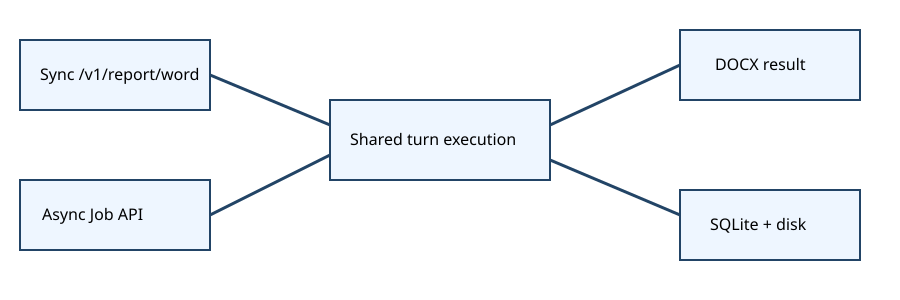
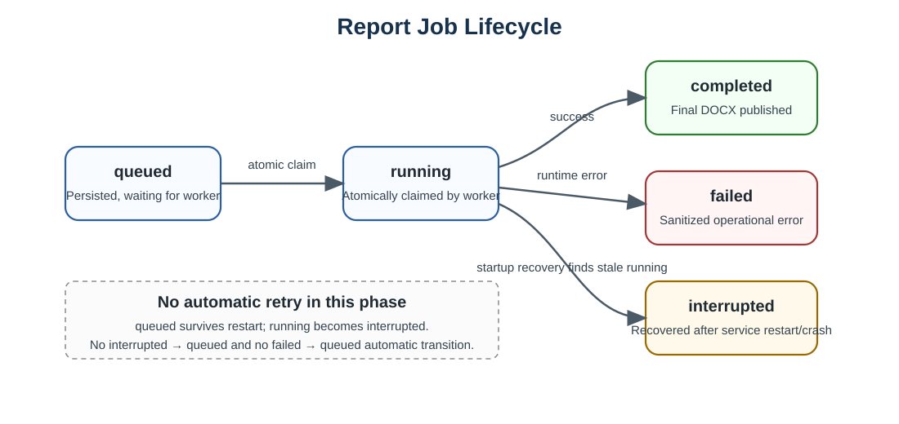

# Dual-mode Word Report API

The synchronous and asynchronous APIs share `execute_agent_turn`, so routing, session history, memory, reuse, and compatibility snapshots do not diverge. The sync endpoint keeps one HTTP connection open and renders the returned turn. The job endpoint persists a request in SQLite and returns a pollable result resource.

At lifespan startup the application initializes SQLite, changes stale `running` rows to `interrupted` in one transaction, and then starts exactly one background worker. The worker atomically claims one `queued` row, converts `prompt` into one user message, passes `session_id` directly to the transport-neutral service, and renders the current result without internal HTTP.

Each database operation owns its SQLite connection and applies a busy timeout. `BEGIN IMMEDIATE` protects idempotent creation and `queued` → `running` claims. `Idempotency-Key` has a UNIQUE constraint; canonical JSON hashing includes prompt, sanitized filename, session, model, supported options, and metadata.

DOCX bytes are written to a job-owned temporary file, flushed, validated, and atomically renamed to `<job_id>.docx`. A caller filename is display metadata only. This is **single-machine persisted job state** with local-disk pollable results—not HA, exactly-once, or crash-resumable execution.

